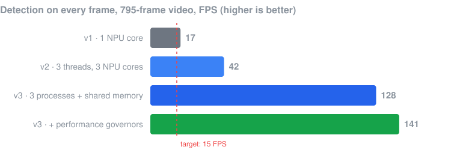
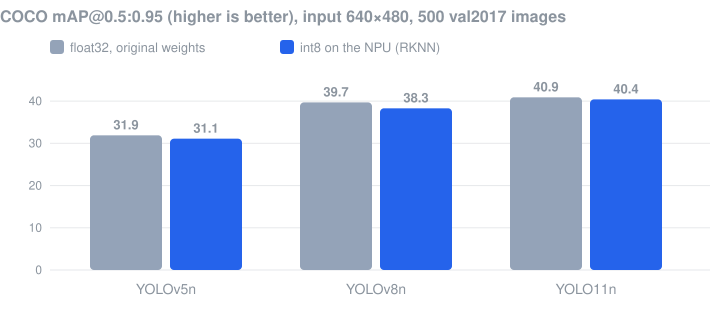

# YOLO detection and tracking on the Rockchip RK3588 NPU

Real-time object detection and tracking on an edge board: YOLO models are converted to RKNN with int8 quantization,
run on the 3-core NPU of an RK3588, and the Python pipeline is optimized from **17 to 141 FPS**.
The final version detects objects once and then follows them with a lightweight neural tracker.

<p align="center">
  
</p>

**Highlights**

- **Conversion and quantization.**
  - YOLOv5n, YOLOv8n and YOLO11n go PyTorch → ONNX → RKNN, with int8 weights and activations.
  - Two calibration sets are compared: COCO images and frames from the target video.
- **Accuracy is measured, not assumed.**
  - COCO mAP is computed for float32 and int8 on 500 val2017 images.
  - Quantization costs only **0.4–1.4 mAP points**.
- **8× faster than the first version.**
  - Work is split across all three NPU cores.
  - Threads are replaced with processes, which removes the GIL bottleneck.
  - Frames are passed through shared memory, and video I/O runs in background threads.
- **Detect once, then track.**
  - NanoTrack, ViTTrack and MIL are compared against a per-frame detector.
  - Custom loss-of-target rules handle edge exits, scale jumps and color mismatch, and remove duplicate boxes.
- **Hardware profiling.**
  - Timings are broken down per stage.
  - Peak memory is tracked.
  - CPU/NPU/DRAM frequency governors are tested.
  - A76 vs A55 core pinning is tried; it turns out to be 9–15 % slower.

The full write-up (in Russian) with methodology, every table and the limitations: [docs/report_ru.md](docs/report_ru.md).

## Hardware

| | |
|---|---|
| Board | Firefly ROC-RK3588S-PC |
| NPU | 3 cores, up to 6 TOPS (int8) |
| CPU | 4 × Cortex-A76 + 4 × Cortex-A55 |
| Memory | 3.8 GB, shared with other users of the board |
| Runtime | Ubuntu 24.04, librknnrt 2.3.2, RKNPU driver 0.9.8, rknn-toolkit-lite2, OpenCV |
| Conversion | PC, rknn-toolkit2 2.3.2 (the same version as the runtime on the board) |

## Results

### Accuracy after int8 quantization

<p align="center">
  
</p>

| Model | Input | Weights | mAP@0.5 | mAP@0.5:0.95 | AP@0.5:0.95, person |
|---|---|---|---|---|---|
| YOLOv5n | 640×480 | float32 | 51.1 | 31.9 | 40.2 |
| YOLOv5n | 640×480 | int8, video calibration | 50.4 | 31.1 | 39.9 |
| YOLOv8n | 640×480 | float32 | 55.7 | 39.7 | 48.8 |
| YOLOv8n | 640×480 | int8, video calibration | 54.5 | 38.3 | 47.3 |
| YOLO11n | 640×480 | float32 | 57.7 | 40.9 | 48.9 |
| YOLO11n | 640×480 | int8, video calibration | 57.1 | 40.4 | 48.0 |

- **640×480 vs 640×640.** The 640×480 input matches the 4:3 video and is as accurate as 640×640 while doing 25 % less work.
- **Effect of quantization.** On frames from the test video, the int8 model finds 97.6 % of the float model's objects, with box IoU 0.97.

### Speed

Detection on every frame, 795-frame video, YOLOv5n 640×480:

| Version | What changed | FPS | NPU inference per frame |
|---|---|---|---|
| v1 | 1 NPU core, 640×640 input | 17 | 42.2 ms |
| v2 | 3 threads, one NPU core each; 640×480; fewer array copies; tracker | 42 (51 without video writing) | 32.0 ms |
| v3 | 3 processes, shared-memory frame ring, reader/writer threads, class filter | **128** | 18.3 ms |
| v3 | + `performance` frequency governors, DRAM 528 → 2112 MHz | **141** | 17.2 ms |

**Why processes are 3× faster than threads.** An NPU call releases the GIL, but to collect its result the thread has to take the GIL back, and it waits while other threads run Python post-processing. That wait even showed up in the measured inference time: 32 ms with threads versus 18.3 ms with processes. Processes cost memory, though: about 1 GB in total instead of 0.44 GB.

### Tracking: detect once, then follow

| | NanoTrack | ViTTrack | MIL |
|---|---|---|---|
| Frames tracked correctly, video with 4 people | **707** | 420 | 332 |
| Frames tracked correctly, moving camera | **565** / 768 | 355 | 316 |
| Time per object on the board | 16–18 ms | 14 ms | 80 ms |

NanoTrack was chosen. ViTTrack is slightly more precise while it holds a target, but it loses the target about twice as early.

Each tracker always returns *some* box, and its own confidence score did not help: NanoTrack reports about 0.87 both on the target and on empty background. So a target is declared lost when one of these holds for 10 frames in a row:
- the box leaves the frame;
- the box hits the side of the frame when the object did not start there;
- the box area jumps by more than 1.6×;
- the HSV histogram inside the box stops matching the target.

A separate filter removes a second box that has jumped onto the same object.

The v5 version runs the same pipeline with YOLOv5n, YOLOv8n and YOLO11n. Because the detector runs rarely, FPS hardly depends on the model, which differ by less than 3 FPS. **YOLO11n therefore adds about 9 mAP points at no speed cost.**

## Architecture

```
v3: detection on every frame                 v4: detect once + tracking
─────────────────────────────                ─────────────────────────────
reader thread  → frame queue                 YOLO on NPU, first frames only
main thread    → shared-memory ring (8)      reader thread → shared memory
  ├─ worker 1: letterbox → NPU core 0 → NMS   main thread → every frame to all workers
  ├─ worker 2: letterbox → NPU core 1 → NMS     ├─ worker 1: NanoTrack, objects A, D
  └─ worker 3: letterbox → NPU core 2 → NMS     ├─ worker 2: NanoTrack, objects B, E
main thread    ← results, reordered by frame    └─ worker 3: NanoTrack, objects C
writer thread  → mp4                         writer thread → mp4
```

The YOLO heads differ by version:
- **YOLOv5:** anchors.
- **YOLOv8 and YOLO11:** anchor-free, with a DFL box distribution and a class-score sum used for early filtering.

In every case box decoding and NMS run on the CPU, because these operations do not survive int8 quantization well.

## Repository layout

| Path | Contents |
|---|---|
| `v2_threads/detect.py` | v2: three threads, one NPU core each |
| `v3_processes/detect.py` | v3: three processes with shared memory, YOLOv5n / v8n / 11n (`--yolo 5\|8\|11`) |
| `v4_tracker/track.py` | v4: detect once, then NanoTrack / ViTTrack / MIL (`--tracker nano\|vit\|mil`) |
| `v5_models/track.py` | v5: v4 with a choice of YOLO version, used for the model comparison |
| `*/bench.sh` | benchmark scripts that print the frequency governors before each run |
| `conversion/convert.py` | ONNX → RKNN, int8, calibration on video frames |
| `conversion/export_v8_v11.sh` | YOLOv8n / YOLO11n → ONNX with the Rockchip forks |
| `conversion/evaluate.py` | COCO mAP for float32 (onnxruntime) and int8 (RKNN simulator) |
| `results/` | raw benchmark logs and an HTML comparison of the three models (in Russian) |
| `set_performance.sh` | pins CPU, NPU and DRAM frequencies to the maximum before a benchmark |

Code comments and console output are in Russian.

## Running

Models and videos are not included. Export the ONNX models with the official Rockchip forks:
- [airockchip/yolov5](https://github.com/airockchip/yolov5) (`export.py --rknpu --include onnx --opset 12`);
- [airockchip/ultralytics_yolov8](https://github.com/airockchip/ultralytics_yolov8) and [airockchip/ultralytics_yolo11](https://github.com/airockchip/ultralytics_yolo11), via `conversion/export_v8_v11.sh`.

Then convert them to RKNN, and put the `.rknn` files into `models/` next to the script you run:

```bash
# PC: convert to RKNN, calibrating on every 16th frame of the video
pip install -r requirements-pc.txt
python conversion/convert.py --onnx yolov5n_480.onnx --out v3_processes/models/yolov5n_480_video.rknn --video your_video.mp4

# board: detection on every frame, or detect once + NanoTrack
pip install -r requirements-board.txt
python v3_processes/detect.py --source your_video.mp4 --save out.mp4
python v4_tracker/track.py --source your_video.mp4 --tracker nano --save out.mp4
```

The trackers use OpenCV's `TrackerNano` and `TrackerVit`. Put their ONNX models into `models/` as `nanotrack_backbone.onnx`, `nanotrack_head.onnx` and `vittrack.onnx`; the OpenCV documentation for these trackers lists where to download them.

For accuracy evaluation, `conversion/evaluate.py` expects the Rockchip forks, a clone of [rknn_model_zoo](https://github.com/airockchip/rknn_model_zoo) and a COCO val2017 subset under `tools/`. Override the location with `TOOLS=/path/to/tools`.

## Limitations

- **Late arrivals are missed.** In v4, objects that appear after the first detection are not tracked, and an object that leaves the frame is not recovered.
- **Long occlusions and crossings break tracks.** A long occlusion loses the target. When small objects cross, the tracker can jump to a neighbor; the duplicate filter removes the extra box, but the original object is no longer followed.
- **Speed scales with the object count.** With many objects, per-frame detection (v3) is faster than one tracker per object on this board.

## License

MIT, for the code in this repository. YOLO models, the Rockchip toolkits and the OpenCV tracker models have their own licenses.
